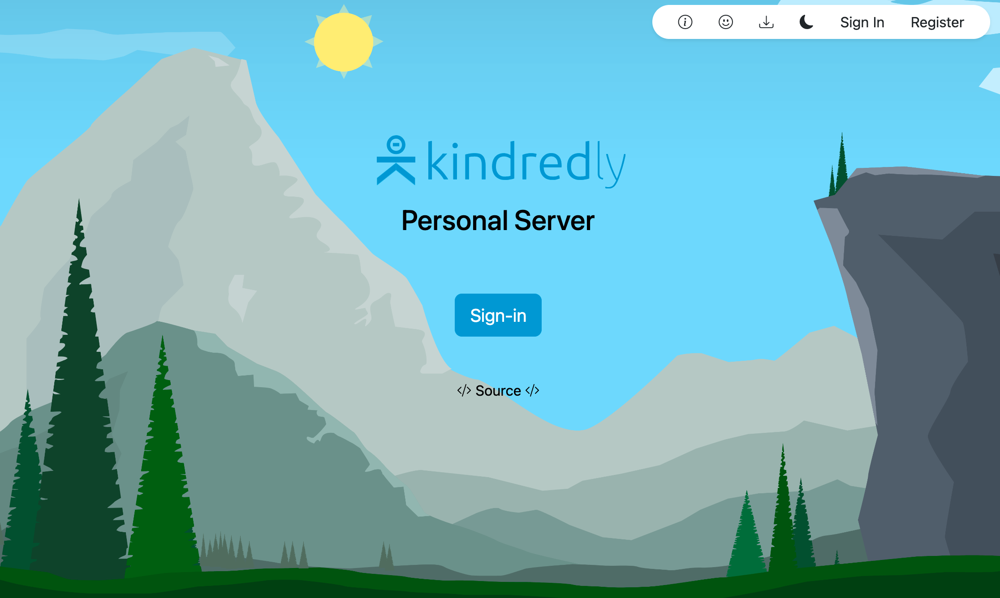

# Kindredly Personal Edition

Kindredly Personal Edition is a free, open-source, and self-hosted version of our Kindredly server designed for individuals and families.



> **NOTE:** This is an **early** release. It will have bugs, and installation is not one click yet. Please stay tuned for updates and better documentation.

## Features
- Private space for individuals and families to store and share content
- Built-in parental control system to manage children's web access (requires browser extension or app)
- Share and give access to content in one action
- Add many types of content, including posts, images, links, notes, videos and files.
- End-to-end encryption for your library and attachments
- Clients for the web, Chrome and Firefox, Android and iOS, and the Companion desktop app

## Requirements
- docker (https://docs.docker.com/get-docker/)
- docker-compose (https://docs.docker.com/compose/); the scripts call the `docker-compose` command, which Docker Desktop includes
- Ports 4444, 3000 and 5435 free on the computer that runs the server

## Installation
1. Clone the repository: `git clone https://github.com/thetaset/kindredly-personal.git`
1. Enter it: `cd kindredly-personal`
1. Run `./build_docker_personal.sh`. The first build takes a while; it also downloads the browser and web-app bundles from the release named in `kindredly-server-personal/data/downloads/RELEASE`.
1. Run `./start_server_personal.sh`. This also runs the database migrations.
1. Visit http://localhost:4444 and create the first account (email is optional). Press ctrl+c to stop the server.

The web app is built for `http://localhost:4444`, so use it on the computer running Docker. To use Kindredly from another device, install the browser extension and point it at this computer (see below).

Your data lives in two places: uploaded files in `~/kindredly-personal-data`, and the database in the `kindredly_postgres` Docker volume. Stop the server before you copy either.

To add another family, sign in as the person who set up the server and open **Settings → Families on this server** for a sign-up link.

## Updating
Stop the server, then run:
```bash
git pull
./build_docker_personal.sh
./start_server_personal.sh
```
The database migrations run as part of the start, and your data is kept. The server tells the admin on Home when a newer version is available.

## Browser Extensions Setup
1. Install the browser extension from https://kindredly.ai/download.
1. On the extension's Sign-In page, open **Login options**.
1. Turn on **Use your own server**.
1. Enter the server's address, including `/api/v3.0`:
   - On the computer running Docker: `http://localhost:4444/api/v3.0`
   - On another device: `http://<computer-ip>:4444/api/v3.0`
1. Press **Test**, then **Save**, and sign in.

## Email (optional)
Kindredly Personal sends invitation and password-reset email. Without a mail server it drops those messages and logs a warning for each; you can still make sign-up and password-reset links in **Settings → Families on this server**.

To send email, add these to both the `kindredly-server-personal` and `kindredly-task-server` services in `docker-compose-personal.yml`:

| Variable | Value |
|---|---|
| `SMTP_HOST` | your mail server |
| `SMTP_PORT` | `587` (STARTTLS) or `465` (TLS) |
| `SMTP_SECURE` | `true` for port 465, otherwise `false` |
| `SMTP_USER` / `SMTP_PASSWORD` | leave both empty for a relay that needs no login |
| `SMTP_FROM` | the address messages come from |

`docker-compose-personal.yml` is tracked, so keep a copy of these edits; `git pull` may ask you to merge them on the next update.

## Current Limitations
These apply only to the personal edition; we plan to address them:
- Push notifications not working
- Email is optional and needs an SMTP server (see above)
- The Docker edition serves plain HTTP. Opening the web app in a browser on another device, or using the phone apps, needs HTTPS — put the server behind a TLS reverse proxy.
- The bundled web app is built for `http://localhost:4444`; other devices use the browser extension.
- Cannot yet sync data into Kindredly Official Server
- Cannot yet access Kindredly Official Server content
- No relay server, so remote access means opening a port and serving it over HTTPS

## Planned Features
- One click installer
- Server management and local web app access in the Companion
- Relay Server for remote access to your server without the need to open ports to your network.
- Scheduled off-site backup
- Integration with Kindredly Published Content
- Better AI-powered features

## License
This software is licensed under the **CC BY-NC 4.0 License**. See [`LICENSE.txt`](LICENSE.txt).

## Contributing
- We are looking for contributors to help us build this project. If you are interested in contributing, please contact us through github or through http://kindredly.ai/contactUs.
